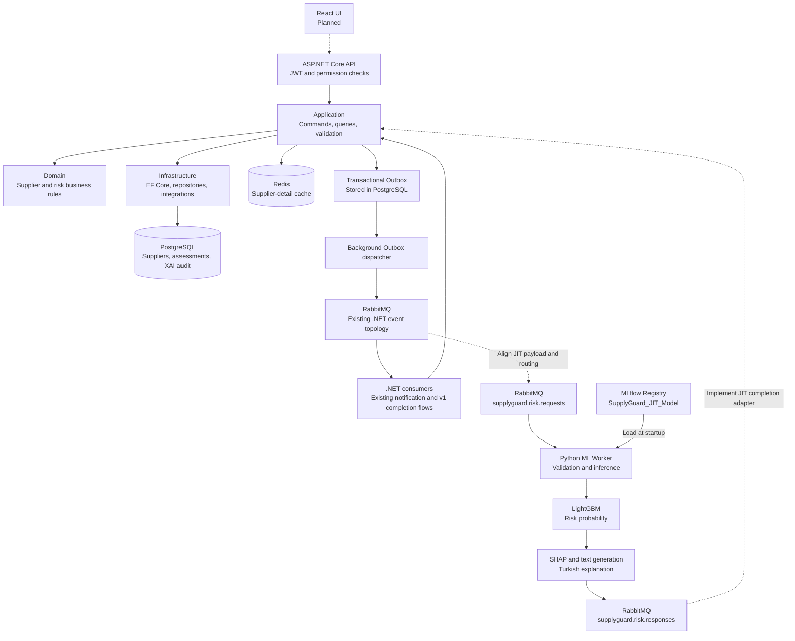

# SupplyGuard

SupplyGuard is a supplier risk assessment and early-warning platform in active development. It brings supplier records, operational risk indicators, and explainable machine learning into one decision-support workflow.

The goal is to help procurement and operations teams identify delivery risk, understand the factors behind a prediction, and trace how a supplier assessment was produced. A LightGBM model estimates risk from six supplier metrics. SHAP identifies the contributing features, and a rule-based text generator produces a Turkish explanation.

The project combines a .NET backend built with Clean Architecture and CQRS with an independently deployed Python ML worker. A React interface is planned for supplier management, risk monitoring, and reviewing explanations.

## Current implementation

| Component | Technology | Current scope |
| --- | --- | --- |
| Backend API | .NET 8, ASP.NET Core | Supplier management, rule-based risk evaluation, early-warning queries and acknowledgement, asynchronous analysis request handling |
| Application design | Clean Architecture, CQRS, built-in dependency injection | Explicit command/query handlers, validation and caching decorators, domain rules |
| Persistence | PostgreSQL, Entity Framework Core | Supplier and risk records, transactional Outbox, append-only XAI audit records |
| Authentication | ASP.NET Core Identity, JWT | Login, refresh/logout flows, role and permission-based authorization |
| Messaging | RabbitMQ, RabbitMQ.Client, aio-pika | .NET Outbox publishing and consumers, Python request/response queues, publisher confirms |
| Caching | Redis | Supplier-detail caching and invalidation, with fallback to the data source on cache failure |
| ML worker | Python 3.13, FastAPI, Pydantic, pandas | Validated message processing, background consumption, readiness endpoint |
| Prediction and explanation | LightGBM, SHAP | Binary risk probability, feature contributions, Turkish explanations |
| Model registry | MLflow | Registered model loading at worker startup |
| Local deployment | Docker, Docker Compose | API, migrations, worker, MLflow, PostgreSQL, Redis, and RabbitMQ |
| Frontend | React | Planned |

**Integration status.** The Python worker has been manually verified through RabbitMQ with high-risk and low-risk inputs, including processing an input queued while the worker was stopped. The .NET backend still uses its existing v1 analysis contracts and routing. Connecting the new LightGBM request/response contract to the API and XAI persistence is the next integration milestone.

## Architecture and message flow

Solid connections show implemented component relationships. Dashed connections show the planned React interface and the contract/routing adapters needed for the LightGBM workflow.



The backend organizes business behavior into four projects.

| Project | Responsibility |
| --- | --- |
| `SupplyGuard.Domain` | Supplier aggregates, risk indicators, assessments, warning lifecycle, and business invariants |
| `SupplyGuard.Application` | Use cases, CQRS handlers, validation, service interfaces, caching decorators, and integration contracts |
| `SupplyGuard.Infrastructure` | EF Core mappings and migrations, PostgreSQL access, Identity, RabbitMQ, Outbox processing, and external-service adapters |
| `SupplyGuard.WebAPI` | HTTP endpoints, authentication/authorization, Swagger, and application composition |

Application depends on Domain. Infrastructure implements the interfaces defined by Application. WebAPI composes these components. The Python worker is a separate process with its own runtime and deployment image.

The design addresses several distributed-system concerns.

- **Durable publication.** The .NET application stages outgoing events in PostgreSQL through the transactional Outbox. Background dispatch marks a message as processed after broker confirmation.
- **Delivery settlement.** The Python worker acknowledges an input after its response publication is confirmed. Durable queues and persistent messages support processing across worker restarts. Delivery is at least once, so the new completion adapter must handle duplicate results.
- **Traceability.** The existing .NET XAI audit model stores request/response payloads, model identity, confidence, latency, and execution outcome. Its unique correlation index supports idempotency in the existing completion flow. The new worker response still needs mapping into this persistence model.
- **Model lifetime.** The worker loads the model and SHAP explainer once at startup. Synchronous inference runs in a background thread. The current worker processes one analysis at a time per process.

## LightGBM analysis

The worker loads `models:/SupplyGuard_JIT_Model/latest` from MLflow and validates the model's feature names and order before consuming messages.

| Input feature | Meaning | Input convention |
| --- | --- | --- |
| `averageDeliveryDelayDays` | Average delivery delay | Days |
| `onTimeDeliveryRate` | Share of deliveries made on time | Ratio, such as `0.95` for 95% |
| `qualityDefectRate` | Share of defective deliveries/items | Ratio, such as `0.004` for 0.4% |
| `DeliveryDelayTrend_Percentage` | Change in delivery delay | Percentage change, such as `-10.0` for improvement |
| `FinancialStabilityScore` | Financial stability measure | Project convention of 0–100 |
| `ActiveRiskIndicatorsCount` | Number of active supplier risk signals | Count |

The Python schema checks that feature values are finite numbers. Domain-specific bounds and agreement with upstream data sources remain part of the integration work.

For each request, the worker calculates the probability of risk class `1`, selects up to two positive SHAP contributions and one negative contribution, and inserts their actual values into a Turkish explanation. Inputs with no positive or negative contributors receive an explicit explanation of that condition.

`ConfidenceScore` is the model's risk probability on a 0–1 scale. The backend's rule-based assessments use a weighted 0–100 score. The completion adapter will define how the ML outcome maps into the application’s assessment and warning policies. SHAP contributions explain the model's raw score; the text generator uses their direction and ranking.

A message can be sent to the default RabbitMQ exchange using routing key `supplyguard.risk.requests`.

```json
{
  "CorrelationId": "demo-analysis-001",
  "SupplierId": "supplier-demo-001",
  "averageDeliveryDelayDays": 2.4,
  "onTimeDeliveryRate": 0.95,
  "qualityDefectRate": 0.004,
  "DeliveryDelayTrend_Percentage": 15.2,
  "FinancialStabilityScore": 80.0,
  "ActiveRiskIndicatorsCount": 3.0
}
```

Responses are published to `supplyguard.risk.responses` with the correlation and supplier identifiers, `ConfidenceScore`, `ExplanationText`, `IsSuccessful`, and nullable `ErrorMessage`. The explanation includes feature values such as `Ortalama Teslimat Gecikmesi (2.4 gün)`.

The .NET JIT request currently nests its metrics under `Features` with different field casing. The existing `POST /api/suppliers/{id}/analyze` endpoint uses the earlier v1 envelope. Payload mapping, exchange bindings, response consumption, and audit metadata must be aligned to complete the API-to-model workflow.

## Repository layout

```text
SupplyGuard/
|-- src/
|   |-- SupplyGuard.Domain/
|   |-- SupplyGuard.Application/
|   |-- SupplyGuard.Infrastructure/
|   `-- SupplyGuard.WebAPI/
|-- supplyguard-ml-worker/
|   |-- main.py             # FastAPI lifecycle and readiness
|   |-- config.py           # Environment settings
|   |-- schemas.py          # ML request/response validation
|   |-- services.py         # MLflow, LightGBM, SHAP, and text generation
|   |-- rabbitmq.py         # Queue consumption and response publishing
|   |-- requirements.txt
|   `-- tests/
|-- tests/
|   |-- SupplyGuard.Domain.Tests/
|   |-- SupplyGuard.Application.Tests/
|   `-- SupplyGuard.IntegrationTests/
|-- docs/
|-- docker-compose.yml
`-- SupplyGuard.sln
```

The worker folder also retains the earlier mock inference and v1 contract modules as development history. The current `main.py` uses `RiskAnalysisService` from `services.py`.

## Run locally

Use Docker Desktop with Docker Compose. Local .NET development requires the .NET 8 SDK. Running Python tooling outside Docker requires Python 3.13 and the worker dependencies.

**Configure a fresh checkout.** Copy the environment example and set your local database password, RabbitMQ password, JWT signing key, and initial administrator credentials.

```powershell
Copy-Item .env.example .env
```

Use a JWT signing key of at least 32 UTF-8 bytes. The initial administrator password must meet the configured Identity policy, including at least 12 characters and uppercase, lowercase, numeric, and special characters. Local values belong in the ignored `.env` file.

**Prepare the model.** The worker expects a trained `LGBMClassifier` registered as `SupplyGuard_JIT_Model` using MLflow's LightGBM flavor. Trained model artifacts and the local MLflow database are provisioned separately from application source.

If the model is already registered in the Compose MLflow instance, continue to startup below. For a fresh local registry, start the supporting services first.

```powershell
docker compose up -d mlflow postgres redis rabbitmq
```

Wait for MLflow to become available at `http://localhost:5000`. Register the supplied classifier with its six matching feature names before starting the worker.

<details>
<summary>Register a locally supplied model in a fresh MLflow instance</summary>

Place the supplied artifact at `supplyguard-ml-worker/lgbm_jit_v1.0.joblib`, create a Python environment, and install the worker dependencies.

```powershell
python -m venv .venv
.\.venv\Scripts\python.exe -m pip install -r supplyguard-ml-worker/requirements.txt
```

Run this registration step once for the supplied artifact. Each subsequent registration creates another model version.

```powershell
@'
import joblib
import mlflow
import mlflow.lightgbm

mlflow.set_tracking_uri("http://localhost:5000")
mlflow.set_registry_uri("http://localhost:5000")
mlflow.set_experiment("SupplyGuard_JIT_Analysis")
model = joblib.load("supplyguard-ml-worker/lgbm_jit_v1.0.joblib")

with mlflow.start_run():
    mlflow.lightgbm.log_model(
        lgb_model=model,
        name="model",
        registered_model_name="SupplyGuard_JIT_Model",
    )
'@ | .\.venv\Scripts\python.exe -
```

</details>

**Start the stack.** Run all commands from the repository root.

```powershell
docker compose up -d --build
docker compose ps -a
```

The migration container applies the database migrations and exits with code `0`. The API starts after migrations succeed. MLflow installs its dependencies during container startup, so its initial startup can take longer than the other services.

| Service | Local address |
| --- | --- |
| API and Swagger | http://localhost:8080/swagger |
| Worker readiness | http://localhost:8000/health |
| MLflow UI and Registry | http://localhost:5000 |
| RabbitMQ management | http://localhost:15672 |
| PostgreSQL | `localhost:5433` |
| Redis | `localhost:6379` |

The API host port can be overridden with `API_PORT`. For a new database, log in through `POST /api/auth/login` using the configured initial administrator username and password.

Inside Docker, the worker connects to `http://mlflow:5000` and the `rabbitmq` service. Compose includes the MLflow allowed-host configuration for these service names.

Check readiness and inspect startup failures with the following commands.

```powershell
curl.exe -i http://localhost:8000/health
docker compose logs --tail 100 ml-worker mlflow
```

Worker readiness returns HTTP `200` after model loading and consumer initialization. RabbitMQ unavailability after startup is reported as HTTP `503`. Model-loading failures prevent the worker from completing startup.

## Validation and next milestones

.NET tests cover domain rules, application use cases, serialization, Outbox behavior, and persistence. Python tests cover validation, inference, SHAP output handling, explanations, and message settlement.

```powershell
dotnet test SupplyGuard.sln
```

With a local Python environment containing the worker dependencies, run the worker tests from the repository root.

```powershell
.\.venv\Scripts\python.exe -m unittest discover -s supplyguard-ml-worker/tests -v
```

The manual worker acceptance checks completed so far are a high-risk prediction, a low-risk prediction, and successful processing of a request queued while the worker was stopped. Model accuracy, probability calibration, and the complete API-to-LightGBM persistence flow require further evaluation.

| Milestone | Planned outcome |
| --- | --- |
| Complete .NET–ML integration | Align JIT message schemas and routing, consume model responses, preserve idempotency, and populate risk assessments and XAI audit records |
| Build the React interface | Authentication, supplier views, risk summaries, early-warning workflows, and explanation/history screens |
| Connect operational data | Replace simulated performance and financial adapters with real data sources and consistent observation windows |
| Extend the LightGBM lifecycle | Evaluate model quality and calibration, make the deployed model version explicit, and support controlled model updates |
| Strengthen operations | Add durable duplicate handling for the new completion flow, safe Outbox coordination for multiple instances, and operational monitoring |

Further implementation notes are available in the [ML Worker guide](supplyguard-ml-worker/README.md), [JIT request integration notes](docs/JIT_RISK_ANALYSIS.md), and [RabbitMQ/Outbox guide](docs/SPRINT7_MESSAGING.md). The [original domain design](docs/ARCHITECTURE.md) and [Phase A walkthrough](docs/SPRINT8_PHASE_A_E2E.md) document earlier milestones and their contracts.

Built by **Fatih Altunel**.
