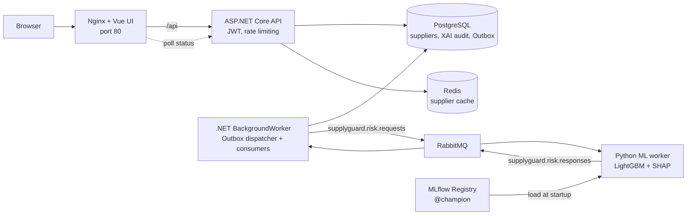

# SupplyGuard

**Live demo: [http://ec2-51-20-202-69.eu-north-1.compute.amazonaws.com](http://ec2-51-20-202-69.eu-north-1.compute.amazonaws.com)**

SupplyGuard is an explainable supplier risk analysis platform for Just-in-Time (JIT) manufacturing. It combines delivery, quality and financial signals into a single risk probability and explains every result with SHAP, so procurement and supply-chain teams can see not only *which* supplier is at risk but also *why*.

The project pairs a .NET 8 backend built with Clean Architecture and CQRS with an independently deployed Python ML worker. They communicate asynchronously through a transactional Outbox and RabbitMQ. A Vue 3 interface served by Nginx lets anyone try the full flow in demo mode.

> **Demo notice.** The deployed instance runs in demo mode: supplier data sources are simulated and the model is trained on synthetic data. Results are illustrative and must not be used for real supplier decisions.

## Try the demo

1. Open the [live demo](http://ec2-51-20-202-69.eu-north-1.compute.amazonaws.com) and click **Demo olarak kullan** (no registration needed).
2. Pick a demo supplier and choose the high-risk or low-risk scenario, or select **Kendi verilerinizi girin** to enter your own six values. Each field explains what it means.
3. Start the analysis. The request is queued, scored by the model and returned within a few seconds, with:
   - a risk gauge showing the model's risk probability,
   - a Turkish SHAP explanation of the main factors,
   - **Model arka planda ne yaptı?** (what the model did in the background), a plain-language walk-through with the real numbers,
   - **Neden bu sonuç?** (why this result), a chart of how much each input pushed the risk up or down.

The demo account can only read suppliers and request or read analyses. Requests are rate-limited per client IP.

## Highlights

| Area | Implementation |
| --- | --- |
| Backend API | .NET 8, ASP.NET Core, Clean Architecture, CQRS with hand-registered handlers and validation/caching decorators (no MediatR) |
| Persistence | PostgreSQL, EF Core migrations, transactional Outbox, append-only XAI audit log with a unique correlation index |
| Messaging | RabbitMQ with publisher confirms, durable queues, quarantine queues and idempotent consumers (at-least-once delivery) |
| ML worker | Python 3.13, FastAPI, aio-pika, Pydantic strict contracts; inference runs off the event loop |
| Model | Monotone-constrained LightGBM, calibrated probabilities, SHAP `TreeExplainer` decomposition in log-odds |
| Model lifecycle | MLflow Model Registry with `@champion` / `@challenger` / `@previous_champion` aliases, quality gates and one-command rollback |
| Frontend | Vue 3 + TypeScript + Vite, hand-drawn SVG charts, no UI framework; static files served by Nginx |
| Security | JWT + permission policies, per-IP rate limiting (`429` + `Retry-After`), startup guard that rejects placeholder or previously published secrets |
| Caching | Redis cache-aside for supplier details, fail-open on cache errors |
| Deployment | Docker Compose; Nginx is the only public entry point, infrastructure ports are bound to loopback |

## Architecture



**End-to-end flow of one analysis**

1. The UI posts six inputs to `POST /api/suppliers/{id}/risk-analyses`. In one transaction, the API stores a pending XAI audit record and an Outbox message, then returns `202 Accepted`.
2. The background worker claims the Outbox row (`FOR UPDATE SKIP LOCKED`) and publishes it to RabbitMQ with publisher confirms.
3. The ML worker computes the risk probability with the `@champion` model, decomposes it with SHAP and writes a Turkish explanation. It acknowledges the request only after its response is confirmed by the broker.
4. The response consumer locks the audit row, records the result exactly once and acknowledges the message after commit. Malformed or conflicting responses go to a quarantine queue.
5. The UI polls `GET /api/suppliers/{id}/risk-analyses/{correlationId}` about every 1.5 seconds until the analysis is `Completed` or `Failed`. The response carries the score, the explanation text and the SHAP breakdown.

| Project | Responsibility |
| --- | --- |
| `SupplyGuard.Domain` | Supplier aggregate, risk indicators, assessments, early-warning lifecycle, XAI audit invariants |
| `SupplyGuard.Application` | Use cases, CQRS handlers, validators, caching decorators, message contracts |
| `SupplyGuard.Infrastructure` | EF Core, Identity/JWT, RabbitMQ, Outbox, demo mode, secret guard |
| `SupplyGuard.WebAPI` | HTTP endpoints, authorization policies, rate limiting, composition root |
| `SupplyGuard.BackgroundWorker` | Outbox publishing and message consumers (no HTTP) |

## Risk model

The model scores six supplier metrics:

| Feature | Meaning | Convention |
| --- | --- | --- |
| `averageDeliveryDelayDays` | Average delay against the promised delivery date | Days |
| `onTimeDeliveryRate` | Share of deliveries on or before the promised date | Ratio (`0.95` = 95%; the UI accepts percent) |
| `qualityDefectRate` | Share of received parts that fail quality control | Ratio (`0.005` = 0.5%) |
| `DeliveryDelayTrend_Percentage` | Change of the last 30 days' delay against the previous 30 days | Percentage points; negative means improving |
| `FinancialStabilityScore` | Financial health of the supplier | 0–100 |
| `ActiveRiskIndicatorsCount` | Currently open risk signals | Count |

The current champion (v2) is a LightGBM classifier with monotone constraints. For example, a longer delay can never lower the risk. It is trained with early stopping and without class weighting, so its probabilities stay calibrated. Every version must pass quality gates before promotion:

- calibration error (ECE) and Brier score;
- the share of extreme predictions;
- monotonicity checks;
- business-defined golden cases (e.g. an ideal supplier stays below 10%, a logistics crisis above 60%).

On its holdout set v2 reached AUC 0.851 and ECE 0.010, with no extreme predictions.

> The training data is **synthetic**: a generator encodes business assumptions as a latent risk function and samples labels from it. The model learns those assumptions; its metrics are not real-world performance.

Training, promotion and rollback are documented in [`supplyguard-ml-worker/training/README.md`](supplyguard-ml-worker/training/README.md). The worker loads `models:/SupplyGuard_JIT_Model@champion`, resolves the alias to a concrete version at startup and reports it in `GET /health`.

## Repository layout

```text
SupplyGuard/
|-- src/                        # .NET solution (Domain, Application, Infrastructure, WebAPI, BackgroundWorker)
|-- tests/                      # xUnit: domain, application and integration tests
|-- supplyguard-ml-worker/
|   |-- main.py, rabbitmq.py    # FastAPI lifecycle, queue consumption
|   |-- services.py, schemas.py # model loading, prediction, SHAP, wire contracts
|   |-- training/               # data generator, training, quality gates, promotion
|   `-- tests/
|-- supplyguard-ui/             # Vue 3 + TypeScript UI, Nginx config, multi-stage Dockerfile
|-- mlflow/                     # MLflow server image (installed at build time)
|-- docs/                       # architecture and integration notes
|-- docker-compose.yml
`-- SupplyGuard.sln
```

## Run locally

Requirements: Docker Desktop with Docker Compose. The .NET 8 SDK is only needed to run the .NET tests outside Docker.

**1. Configure secrets.** Copy the example file and replace every `<YOUR_...>` value with a new random secret.

```powershell
Copy-Item .env.example .env
```

Generate each value separately (works in Windows PowerShell 5.1 and PowerShell 7):

```powershell
$b = New-Object byte[] 48; [Security.Cryptography.RandomNumberGenerator]::Create().GetBytes($b); [Convert]::ToBase64String($b).TrimEnd('=').Replace('+','-').Replace('/','_')
```

The initial administrator password needs at least 12 characters with upper and lower case, a digit and a symbol. The API refuses to start with placeholders or with any secret that was ever committed to this public repository.

**2. Start the stack.**

```powershell
docker compose up -d --build
docker compose ps -a
```

The `migrations` container applies database migrations and exits with code `0`; the API starts afterwards. Compose runs in demo mode by default (`DEMO_MODE=true`), which seeds three demo suppliers and the demo account.

**3. Provide a model (first run only).** On a fresh MLflow registry, train and promote a model inside the worker image, so library versions match inference exactly:

```powershell
docker compose run --rm --no-deps -v "${PWD}/supplyguard-ml-worker:/work:ro" -w /work ml-worker python training/train.py --tracking-uri http://mlflow:5000
docker compose run --rm --no-deps -v "${PWD}/supplyguard-ml-worker:/work:ro" -w /work ml-worker python training/promote.py --tracking-uri http://mlflow:5000
docker compose restart ml-worker
```

| Service | Address |
| --- | --- |
| Web UI (public entry point) | http://localhost |
| API and Swagger | http://localhost:8080/swagger |
| Worker readiness and model version | http://localhost:8000/health |
| MLflow UI and Registry | http://localhost:5000 |
| RabbitMQ management | http://localhost:15672 |
| PostgreSQL / Redis | `localhost:5433` / `localhost:6379` |

Only the web UI is published on all interfaces; every other port is bound to `127.0.0.1`. The UI port can be changed with `WEB_PORT`.

## Tests

```powershell
# .NET: domain, application and integration tests
dotnet test SupplyGuard.sln

# Python worker: contracts, inference, SHAP, messaging and model-quality gates
cd supplyguard-ml-worker; ..\.venv\Scripts\python.exe -m unittest discover -s tests -v

# UI: Vitest, type check and production build (no local Node.js required)
docker run --rm -v "${PWD}/supplyguard-ui:/app" -w /app node:22-alpine sh -c "npm ci && npm test && npm run build"
```

Live integration tests against a real PostgreSQL and RabbitMQ are opt-in; see [`docs/BACKGROUND_RISK_ANALYSIS.md`](docs/BACKGROUND_RISK_ANALYSIS.md).

## Deployment

The live demo runs on AWS EC2 (`eu-north-1`) with Docker Compose. Nginx on port 80 is the only public entry point and proxies `/api` to the API on the internal Compose network. Demo mode is enabled there: supplier data sources are simulated and anonymous users sign in through the shared demo account.

## Known limitations and next steps

- **Data:** the model is trained on synthetic data and the delivery-trend and financial sources are simulated; real ERP and financial integrations are not connected yet.
- **Transport:** the demo is served over HTTP; TLS (port 443) is planned.
- **Infrastructure:** MLflow and Redis have no authentication and rely on loopback-only ports. The MLflow image uses Python 3.10, which reached end of life in October 2026. MLflow also has no healthcheck.
- **Traceability:** the worker reports its model version in `/health`, but the XAI audit record does not store it yet.
- **Legacy:** the earlier v1 analysis endpoint (`POST /api/suppliers/{id}/analyze`) is still registered, but no worker consumes its queue.

## Documentation

- [Architecture analysis](docs/ARCHITECTURE.md): services, contracts, risks and their status
- [ML worker guide](supplyguard-ml-worker/README.md) and [model training and promotion](supplyguard-ml-worker/training/README.md)
- [Background risk analysis integration](docs/BACKGROUND_RISK_ANALYSIS.md) and [JIT request notes](docs/JIT_RISK_ANALYSIS.md)
- [RabbitMQ and Outbox](docs/SPRINT7_MESSAGING.md)

## License

SupplyGuard's original source code is source-available under the [PolyForm Noncommercial License 1.0.0](LICENSE). Use, modification, and redistribution are permitted for the purposes specified in the license, including its noncommercial and specified organizational uses.

Commercial uses outside the permissions granted by this license require separate written permission from Fatih Altunel. Third-party dependencies remain subject to their own licenses. The full terms in [LICENSE](LICENSE) govern use of the project.

Required Notice: Copyright (c) 2026 Fatih Altunel

Built by **Fatih Altunel**.
